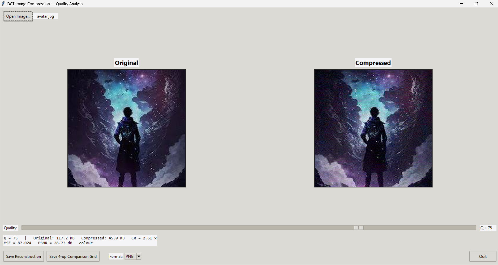
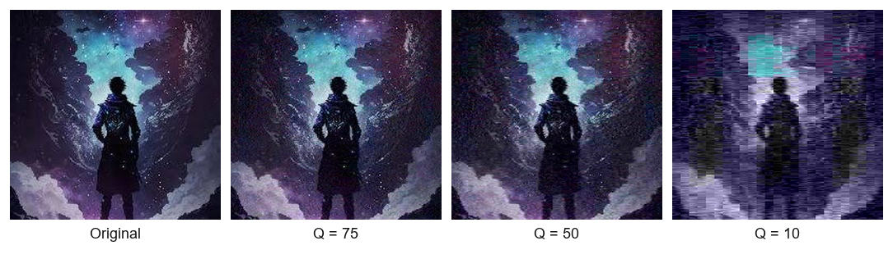

# DCT-Based Image Compression & Quality Analysis

A from-scratch implementation of JPEG-style lossy image compression using the
2-D Discrete Cosine Transform (DCT), with explicit measurement of the
storage-vs-quality trade-off via MSE, PSNR, and compression ratio.

> **One-line summary:** Take an image → split into 8×8 blocks → DCT →
> quantize (JPEG luminance table) → dequantize → inverse DCT → reconstructed
> image → measure the difference.

The math (DCT, IDCT, block splitting, quantization tables, MSE, PSNR) is all
implemented from scratch in NumPy. We do not call `scipy.fft.dct` so the
signal-processing chain stays visible for the live demo and classroom presentation.

---

## 🎓 Course Presentation & Viva Defense: The Educational Pop-up Window

To make the project 100% explainable to your course instructor and examiners, the app features an interactive **Algorithms, Flowchart & Numerical Calculations Pop-up Window**:



Simply click **`[📘 Flowchart, Algorithms & Math (Pop-up)]`** in the top bar or **`[🔬 View Algorithms & Calculations]`** in the action bar. The pop-up opens with 5 dedicated interactive tabs:

1. **📋 Tab 1: Pipeline Flowchart:** Complete end-to-end signal processing architecture (Level shifting → Block Partitioning → 2-D DCT → Psychovisual Quantization → Zig-zag/RLE → Dequantization → IDCT → Reconstruction → Error Metrics).
2. **⚙️ Tab 2: Step-by-Step Algorithms:** Formal DIP algorithms with inputs, outputs, mathematical properties, and pseudocode (DCT-II, Quantization table scaling, Zig-zag traversal, IDCT-III, BT.601 color transform).
3. **📐 Tab 3: Mathematical Formulas:** Clean reference of all governing equations with symbol definitions ($F(u, v)$ summation, orthonormal basis $D$, $Q_{50}$ standard table, libjpeg scaling function $S(Q)$, $MSE$, $PSNR$, $CR$, and $BPP$).
4. **🔢 Tab 4: Live 8×8 Numerical Walkthrough:** Step-by-step numerical calculations on an actual 8×8 block (switchable between the classic Gonzalez & Woods textbook block and actual blocks from your loaded image). Shows:
   - Step 1: Original pixel intensities ($8 \times 8$)
   - Step 2: Level-shifted values ($f - 128$)
   - Step 3: 2-D DCT frequency coefficients with DC value and % energy compaction
   - Step 4: Scaled quantization table $Q_{scaled}$ for the active $Q$
   - Step 5: Quantized integers $F_Q$ with exact count and percentage of zeros
   - Step 6: 1D zig-zag array and Run-Length Encoded (run, val) pairs
   - Step 7: Dequantized coefficients $F'_Q$
   - Step 8: Reconstructed pixels $f'_{recon}$
   - Step 9: Residual error matrix, local block MSE, and local block PSNR
5. **📊 Tab 5: Image Metrics Derivation:** Full step-by-step arithmetic derivation of how total dimensions, raw bytes, compressed bytes, CR, BPP, MSE, and PSNR were computed for the whole image.
6. **💾 Academic Report Export:** One-click button to export the entire mathematical and numerical analysis to a submission-ready `.txt` file!

---

## Repository layout

```
.
├── dct_core/                  # DCT/IDCT math + quantization + educational core
│   ├── dct.py                 #   from-scratch 8×8 DCT/IDCT (single + batch)
│   ├── blocks.py              #   split image into 8×8 blocks, merge back
│   ├── quant.py               #   JPEG luminance table, Q-scaling, quantize/dequantize
│   └── explanation.py         #   flowcharts, algorithms, formulas & live block calculations
├── quality/                   # Quality metrics
│   └── metrics.py             #   MSE, PSNR, compression ratio, zig-zag byte estimator
├── pipeline/                  # End-to-end orchestration
│   ├── color.py               #   RGB ↔ YCbCr (BT.601 full-range)
│   └── pipeline.py            #   grayscale + colour compress_image entry point
├── io_utils/                  # Image I/O + 4-up comparison grid
│   └── io.py
├── app/                       # Tkinter GUI (with live theory & calculations pop-up)
│   ├── gui.py                 #   main desktop GUI
│   └── theory_dialog.py       #   interactive educational pop-up window
├── benchmarks/                # Quality-vs-size sweep over Q values
│   └── run_bench.py
├── tests/                     # 32 unit + integration tests
├── assets/                    # sample images (drop your own photo here)
├── main.py                    # CLI demo (single image + --explain + --report)
├── requirements.txt
├── PROGRESS.md                # step-by-step easy-words diary
├── Guide.md                   # viva preparation guide
└── README.md                  # ← this file
```

## Install

```bash
python -m pip install -r requirements.txt
```

Tested on Windows + Python 3.10 with `numpy`, `Pillow`, `pytest`.

## How to run

### CLI demo (single image)

```bash
python main.py                                  # uses assets/sample.png, Q=75
python main.py my_photo.jpg                     # any image, default Q=75
python main.py my_photo.jpg -q 10               # very compressed, visible blocks
python main.py my_photo.jpg --no-color          # force grayscale pipeline
python main.py my_photo.jpg --grid              # also write a 4-up comparison grid
python main.py assets/sample.png -q 50 --explain # print flowchart, algorithms & numerical calculations
python main.py assets/sample.png --report submission_report.txt # save complete academic report
```

The console prints the summary card (original size, compressed size,
compression ratio, MSE, PSNR) and saves `*_recon_q<Q>.png` next to the
input. With `--grid` it also saves a 4-up montage `*_comparison.png` of
`Original | Q=90 | Q=50 | Q=10`.

With `--explain`, it prints the complete visual flowchart, algorithms, formulas, and 8x8 block calculations directly in the terminal for presentation during evaluation.

### Tkinter GUI

```bash
python app/gui.py
```

Open an image, drag the quality slider (1–100), and watch the preview and metrics update live.
Click **`[📘 Flowchart, Algorithms & Math (Pop-up)]`** to open the interactive educational window.

> The GUI requires Tk. On a stock Windows / macOS Python install it just
> works. On minimal Linux distributions install `python3-tk`.

### Tests

```bash
python -m pytest tests/ -v
```

32 unit + integration tests covering DCT round-trip, quantization error
bounds, MSE/PSNR, full grayscale and colour pipelines, numerical calculation
walkthroughs, and GUI lifecycle.

---

## The signal-processing chain

```
Input image (uint8, H × W × {1|3})
       │
       ├── grayscale ─────────────────►  level-shift by −128
       │                                   │
       └── colour (RGB) ─► RGB → YCbCr ───► split into 8 × 8 blocks (reflect-pad if needed)
                                          ▼
                                  2-D DCT per block (vectorized)
                                          ▼
                          quantize: round(coefficients / table)
                                          ▼
                          dequantize: qcoeffs × table
                                          ▼
                                inverse 2-D DCT per block
                                          ▼
                                  merge blocks back into image
                                          ▼
                                  inverse level-shift (+ 128)
                                          ▼
                                  clip to [0, 255], cast to uint8
                                          ▼
                          compare to original → MSE, PSNR, CR
```

### Why DCT?

Real images are mostly *slowly varying*. The DCT packs most of the signal
energy into a small number of low-frequency coefficients (top-left of each
8×8 block) and leaves the rest mostly near zero. The quantization table is
chosen to round those near-zero high-frequency coefficients aggressively
while preserving the bright top-left coefficients — exactly the asymmetric
treatment the human visual system is most tolerant of.

### Why Q=50?

Q=50 is the JPEG *reference* quality. The quantization table hard-coded in
`dct_core/quant.py` is the standard JPEG luminance table at Q=50. The same
table can be re-scaled for any Q in [1, 100] using `scale_table`.

### What "compression ratio" means here

We compare against the *raw pixel size* (one byte per pixel for grayscale,
three bytes per pixel for RGB) — the honest baseline that lets you see how
much your DCT pipeline is shrinking the data, independent of the
PNG/ZIP wrapper on top.

---

## Quality metrics

| Metric | Definition | Notes |
|--------|-----------|-------|
| MSE | `mean((original − reconstructed)²)` | Lower is better. |
| PSNR | `10·log10(255² / MSE)` dB | Higher is better. `inf` for lossless. |
| CR   | `original bytes / compressed bytes` | Higher is more compression. |
| BPP  | `(compressed bytes * 8) / (W * H)` | Bits per pixel. |

Typical measured values (the colour sample in `assets/sample_color.png`):

| Q    | CR (×) | MSE    | PSNR (dB) | Visual feel           |
|------|-------:|-------:|----------:|-----------------------|
| 5    | 17.78  | 932.40 | 18.43     | heavy blocking, poster |
| 25   |  8.12  | 350.69 | 22.68     | visible 8×8 squares    |
| 50   |  5.88  |  96.83 | 28.27     | small visible artifacts|
| 75   |  4.61  |  57.28 | 30.55     | nearly indistinguishable|
| 95   |  2.33  |  39.56 | 32.16     | visually lossless      |

---

## Examples

Below are examples generated directly from the tool, showcasing both JPG and PNG export formats, as well as the 4-up comparison grid.

### Single Reconstruction
Here is a reconstructed image saved directly from the tool:


### 4-Up Comparison Grid
The tool can automatically generate a grid showing the Original image compared against Q=90, Q=50, and Q=10 to visually demonstrate the degradation in quality as the file size shrinks:



